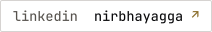
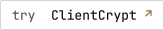
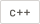
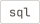
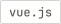
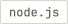
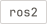
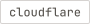

<h1 align="center">Nirbhay Aggarwal</h1>

<strong>Software Engineer</strong> · Security &amp; ML Security · Homelab Builder

  
  <a href="https://linkedin.com/in/nirbhayagga/">
    <picture><source media="(prefers-color-scheme: dark)" srcset="badges/dark/linkedin.svg"></picture>
  </a>
  <a href="mailto:hi@nirbhay.dev">
    <picture><source media="(prefers-color-scheme: dark)" srcset="badges/dark/mail.svg"></picture>
  </a>

  <strong>Live projects:</strong> 
  <a href="https://wikigolf.app">
    <picture><source media="(prefers-color-scheme: dark)" srcset="badges/dark/live-wikigolf.svg"></picture>
  </a>
  <a href="https://sudoku.nirbhay.dev">
    <picture><source media="(prefers-color-scheme: dark)" srcset="badges/dark/live-sudoku.svg"></picture>
  </a>
  <a href="https://boardroom.nirbhay.dev">
    <picture><source media="(prefers-color-scheme: dark)" srcset="badges/dark/live-boardroom.svg"></picture>
  </a>
  <a href="https://clientcrypt.nirbhay.dev">
    <picture><source media="(prefers-color-scheme: dark)" srcset="badges/dark/live-clientcrypt.svg"></picture>
  </a>
  <a href="https://stepwise.nirbhay.dev">
    <picture><source media="(prefers-color-scheme: dark)" srcset="badges/dark/live-stepwise.svg"></picture>
  </a>
  <a href="https://ragshield.dev">
    <picture><source media="(prefers-color-scheme: dark)" srcset="badges/dark/live-rag-shield.svg"></picture>
  </a>
  <a href="https://rallyradio.onrender.com">
    <picture><source media="(prefers-color-scheme: dark)" srcset="badges/dark/live-rally-radio.svg"></picture>
  </a>

---

### About Me

I'm a software engineer pursuing an **MS in Computer Science at UNLV** (expected May 2027), after finishing my BS in 2025. Lately that work is AI security: change control for the documents RAG pipelines read, and LLM-rewritten phishing. I build software to explore what I'm learning and to solve problems for people I know.

I work as a **Public Service Intern at UNLV OIT**, where I lead the annual audit verification of 8,000+ IT assets, and run a Proxmox and TrueNAS homelab. Open to full-time security, AppSec, and ML security roles starting in **2027**, as well as software and infrastructure work.

---

### Highlighted Projects

- **[RAG Shield](https://ragshield.dev):** Change control for the documents a RAG pipeline reads. Scores only what each edit adds, holds risky edits for review while the previous version keeps serving, and signs every chunk (SHA-256 plus an Ed25519 ledger) so tampered or unknown chunks are dropped before the model sees them. Caught 125 of 125 direct vector-store edits; a classifier fine-tuned on public data raised detection of prompt-injection edits from 23% to 96.0% on held-out documents with a calibrated threshold, flagging 0 of 62 benign edits. Coursework startup project, released as open source: [source](https://github.com/nirbhayagga/rag-shield), [`pip install rag-shield`](https://pypi.org/project/rag-shield/), and the classifier on [Hugging Face](https://huggingface.co/nirbhayagga/ragshield-injection-v5).
- **PhishGuard:** Can LLM rewrites get phishing past detectors? A 28,899-email corpus with links scored in a separate channel, TF-IDF and DistilBERT detectors, and LLM-rewrite and adaptive attacks. Rewrites rarely evaded (0.4–3.1% at 1% FPR) and Claude refused most requests, but every trained detector ranked poorly on modern email (AUC 0.52–0.71) while zero-shot Claude Opus reached 0.96–0.99. Course project; source private for now.
- **[WikiGolf](https://wikigolf.app):** A two-pass Rust parser turns the English Wikipedia dump into a 7.2M-article link graph. The public game runs as a static export; a separate Rust server supports live path queries.
- **[PalDash](https://github.com/paldash/paldash):** Built for the Palworld server I host for friends. Combines monitoring and a world map with binary save editing, server-state checks, verified backups, and rollback checks.
- **[ClientCrypt](https://clientcrypt.nirbhay.dev):** Started with my cryptography coursework. RustCrypto runs in WebAssembly, inputs stay in the browser, and FIPS/RFC test vectors check the results.
- **[Stepwise](https://stepwise.nirbhay.dev):** Started with my algorithms coursework. Recorded execution frames let you step backward through algorithms, CPU schedules, and simulated thread interleavings.

Also built [Sudoku](https://sudoku.nirbhay.dev) for ad-free play with generated puzzles, hints, and a custom solver; [Boardroom](https://boardroom.nirbhay.dev) for remote game nights; [Rally Radio](https://rallyradio.onrender.com), a browser kart racer where a blindfolded driver follows a sighted navigator's calls; and firetv-reclaim, which replaces a Fire TV's ad-filled home screen without root. **Boardroom's hosted demo is AI-only; online multiplayer requires the self-hosted Node server.**

Team and coursework projects include F1tenth autonomous racing (our team placed first in four races; I managed the shared codebase), the Espresso compiler, and a Steam-review helpfulness paper, submitted to ITNG 2027 (under review), for which I built the scraper, the ETL and the first ML runs, then rebuilt the study as a one-command pipeline that reproduced its main table on a fresh machine. A semester of CS 789 AI-security assignments added a SOC copilot over a 37,808-alert knowledge graph, n8n and vLLM triage of live Wazuh alerts, phishing-detector distillation and a labels-only extraction attack, and DeepFool and Carlini-Wagner attacks written from scratch.

I also build **Silt**, a Rust version control system with Git-compatible interchange, and **Interlay**, experimental languages whose interpreters run commit and merge-policy hooks for Silt.

My **[Mario PPO agent](https://github.com/nirbhayagga/mario-ai)** cleared World 1-1 in 10/10 evaluation episodes after 10M training steps; results are limited to that trained level.

---

### Tech Stack

**Languages:** 
<picture><source media="(prefers-color-scheme: dark)" srcset="badges/dark/stack-python.svg"></picture>
<picture><source media="(prefers-color-scheme: dark)" srcset="badges/dark/stack-java.svg"></picture>
<picture><source media="(prefers-color-scheme: dark)" srcset="badges/dark/stack-cpp.svg"></picture>
<picture><source media="(prefers-color-scheme: dark)" srcset="badges/dark/stack-rust.svg"></picture>
<picture><source media="(prefers-color-scheme: dark)" srcset="badges/dark/stack-javascript.svg"></picture>
<picture><source media="(prefers-color-scheme: dark)" srcset="badges/dark/stack-typescript.svg"></picture>
<picture><source media="(prefers-color-scheme: dark)" srcset="badges/dark/stack-sql.svg"></picture>

**Frameworks & Infrastructure:** 
<picture><source media="(prefers-color-scheme: dark)" srcset="badges/dark/stack-react.svg"></picture>
<picture><source media="(prefers-color-scheme: dark)" srcset="badges/dark/stack-astro.svg"></picture>
<picture><source media="(prefers-color-scheme: dark)" srcset="badges/dark/stack-vuejs.svg"></picture>
<picture><source media="(prefers-color-scheme: dark)" srcset="badges/dark/stack-nodejs.svg"></picture>
<picture><source media="(prefers-color-scheme: dark)" srcset="badges/dark/stack-pytorch.svg"></picture>
<picture><source media="(prefers-color-scheme: dark)" srcset="badges/dark/stack-transformers.svg"></picture>
<picture><source media="(prefers-color-scheme: dark)" srcset="badges/dark/stack-docker.svg"></picture>
<picture><source media="(prefers-color-scheme: dark)" srcset="badges/dark/stack-ros2.svg"></picture>
<picture><source media="(prefers-color-scheme: dark)" srcset="badges/dark/stack-proxmox.svg"></picture>
<picture><source media="(prefers-color-scheme: dark)" srcset="badges/dark/stack-cloudflare.svg"></picture>

---

  <em>Open to full-time roles in Security Engineering, AppSec, and ML Security beginning in 2027.</em>

